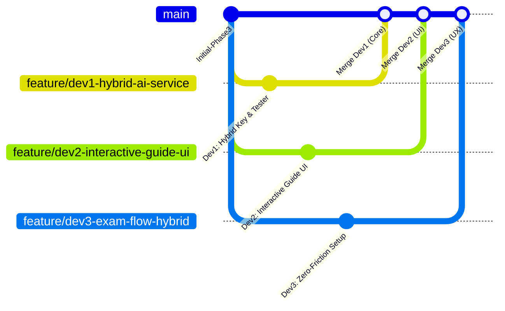

# 🚀 Edublox: Parallel Implementation Plan (Hybrid AI & Interactive Guide)

Dokumen ini dirancang untuk dieksekusi oleh **3 Developer secara paralel** tanpa konflik git (*zero overlap*). Masing-masing developer memiliki area tanggung jawab file, interface kontrak, dan branch git yang terisolasi.

---

## 👥 Matriks Pembagian Tugas (Zero-Conflict)

| Developer | Domain Fokus | Branch Git | File yang Dikerjakan (Exclusive) |
|---|---|---|---|
| **Dev 1 (Core & Service)** | Hybrid Key Resolver, Env & Connection Tester | `feature/dev1-hybrid-ai-service` | `src/services/aiService.ts`<br>`src/hooks/useAIKey.ts`<br>`.env.example` |
| **Dev 2 (Settings & Guide UI)** | Interactive UI Guide, Linking & Custom Key Form | `feature/dev2-interactive-guide-ui` | `src/screens/AIKeyInputScreen.tsx`<br>`src/components/AIGuideModal.tsx` *(new)* |
| **Dev 3 (Exam Flow & UX)** | Setup Screen Hybrid Banner & Zero-Friction Flow | `feature/dev3-exam-flow-hybrid` | `src/screens/SetupScreen.tsx`<br>`src/types/index.ts` |

---

## 📐 Kontrak Interface Bersama (Shared Contract)
> ⚠️ **PENTING**: Semua developer **TIDAK BOLEH** mengubah nama fungsi/tipe ini agar saat merge tidak terjadi type error.

Di file `src/types/index.ts` (sudah disepakati):
```typescript
export type AIProvider = 'openai' | 'gemini' | 'claude';

export interface AIKeyConfig {
  provider: AIProvider;
  customKey: string | null;
  useSystemDefault: boolean; // true = pakai Gemini Free dari sistem
}

export interface ConnectionTestResult {
  success: boolean;
  message: string;
}
```

---

## 🛠️ Rincian Tugas Developer 1: Backend & Service Layer
**Nama Branch:** `feature/dev1-hybrid-ai-service`  
**Tujuan:** Mengatur fallback otomatis ke System Free Key (Gemini) dan membuat fungsi test koneksi.

### Spesifikasi Teknis:
1. **`.env.example`**:
   - Tambahkan variabel: `EXPO_PUBLIC_SYSTEM_GEMINI_KEY=your_free_gemini_api_key_here`
2. **`src/services/aiService.ts`**:
   - Tambahkan method `getActiveKey(provider?: AIProvider): Promise<string>`:
     - Cek apakah user menyimpan custom key di `keyStorageService`.
     - Jika ada dan disetel aktif, gunakan custom key.
     - Jika tidak ada, gunakan `process.env.EXPO_PUBLIC_SYSTEM_GEMINI_KEY`.
   - Tambahkan method `testConnection(provider: AIProvider, key: string): Promise<ConnectionTestResult>`:
     - Melakukan 1 request ringan ke endpoint Gemini/OpenAI untuk memastikan key valid (bukan typo/expired).
3. **`src/hooks/useAIKey.ts`**:
   - Sediakan state: `isUsingSystemKey`, `hasCustomKey`, `activeProvider`.

### Checklist Selesai Dev 1:
- [ ] Fallback ke `EXPO_PUBLIC_SYSTEM_GEMINI_KEY` berjalan mulus jika custom key kosong.
- [ ] `testConnection()` mengembalikan `success: true` jika key valid, dan pesan error ramah jika salah.
- [ ] Unit test `npm test` tetap 100% pass.

---

## 🎨 Rincian Tugas Developer 2: UI Panduan Interaktif
**Nama Branch:** `feature/dev2-interactive-guide-ui`  
**Tujuan:** Membuat layar pengaturan AI yang ramah pemula dengan panduan 3 langkah & direct link.

### Spesifikasi Teknis:
1. **`src/screens/AIKeyInputScreen.tsx`**:
   - **Mode Selector (Tab / Switch):**
     - Opsi A: `🟢 Gunakan Gemini Sistem (Gratis & Siap Pakai)` (Default).
     - Opsi B: `⚙️ Gunakan API Key Sendiri (Custom)`.
   - **Bagian Panduan Interaktif (Bila memilih Gemini):**
     - Card visual 3 langkah mudah:
       1. Klik tombol **"Buka Google AI Studio"** (gunakan `Linking.openURL('https://aistudio.google.com/app/apikey')`).
       2. Login akun Google dan klik **"Create API Key"**.
       3. Salin key lalu tempel di kolom input Edublox.
   - **Field Input & Tombol Verifikasi:**
     - Tombol **"Paste dari Clipboard"**.
     - Tombol **"Cek Koneksi Key"** (memanggil fungsi dari Dev 1 / dummy saat testing).
     - Status badge: `✅ Key Valid & Aktif` atau `❌ Key Tidak Valid`.

### Checklist Selesai Dev 2:
- [ ] Tombol eksternal link berhasil membuka Google AI Studio di browser HP.
- [ ] Desain responsif, bersih, dan tidak membingungkan pengguna awam.
- [ ] User bisa memilih mode Default vs Custom Key.

---

## 📱 Rincian Tugas Developer 3: Exam Setup & Zero-Friction Flow
**Nama Branch:** `feature/dev3-exam-flow-hybrid`  
**Tujuan:** Memastikan user baru tidak diblokir saat mau mulai ujian.

### Spesifikasi Teknis:
1. **`src/screens/SetupScreen.tsx`**:
   - Hapus / sesuaikan validasi yang sebelumnya memblokir *"Anda belum memasukkan API Key"*.
   - Jika user tidak punya custom key, otomatis tampilkan info badge:
     - `✨ Menggunakan Gemini AI Gratis (Sistem)`
   - Tambahkan link kecil: *"Ingin pakai key sendiri? Atur di Pengaturan"*.
   - Saat tombol **"Mulai Ujian"** diklik, panggil generator soal langsung tanpa pop-up peringatan API key.
2. **Error Handling Saat Kuota Sistem Penuh:**
   - Jika request gagal karena rate limit (429), beri instruksi jelas:
     - *"Server sedang ramai. Coba 1 menit lagi, atau masukkan API Key pribadimu di Pengaturan untuk akses bebas antrean."*

### Checklist Selesai Dev 3:
- [ ] User baru yang baru selesai register bisa langsung generate soal tanpa buka halaman Settings.
- [ ] Banner mode AI tampil informatif di SetupScreen.
- [ ] Penanganan error kuota memberikan opsi yang jelas ke user.

---

## 🔄 Prosedur Kerja & Merge Tanpa Konflik



### Aturan Merge (Urutan PR):
1. **PR #1 (Dev 1):** Merge lebih dulu ke `main` sebagai pondasi service.
2. **PR #2 (Dev 2):** Pull update `main`, sambungkan tombol UI ke service Dev 1, lalu merge.
3. **PR #3 (Dev 3):** Pull update `main`, sesuaikan navigasi & banner, lalu merge.
